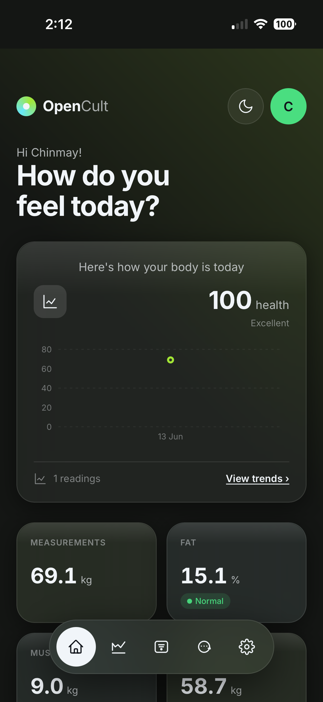
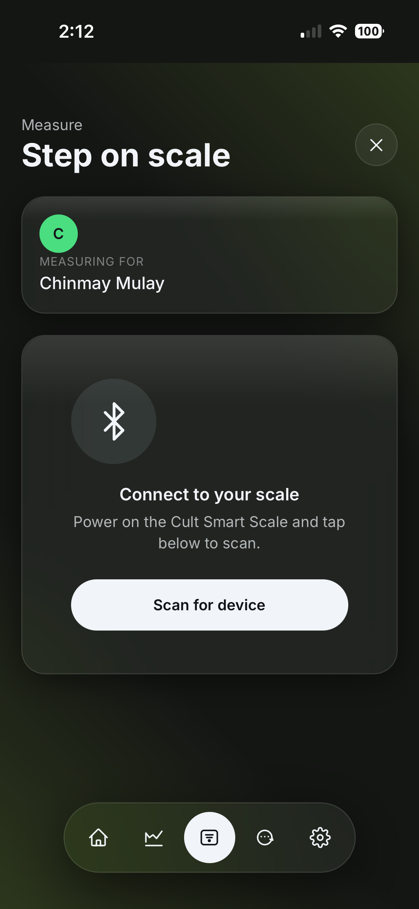
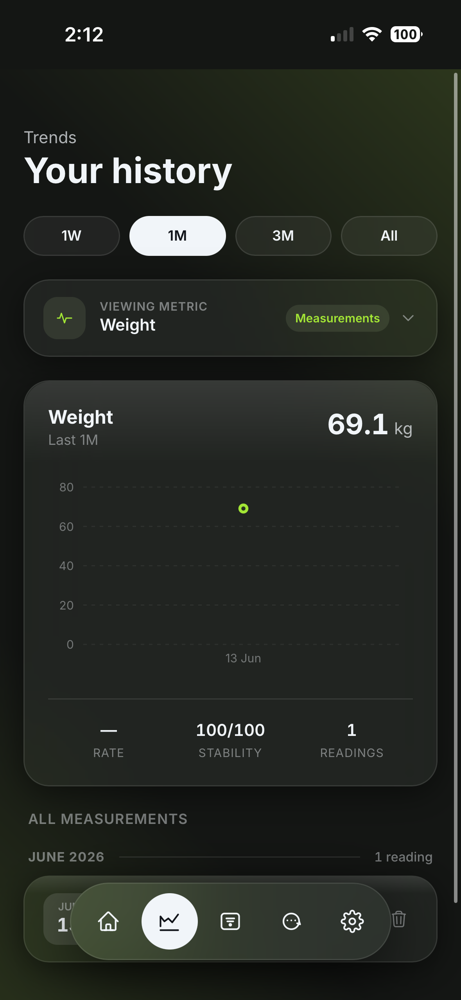
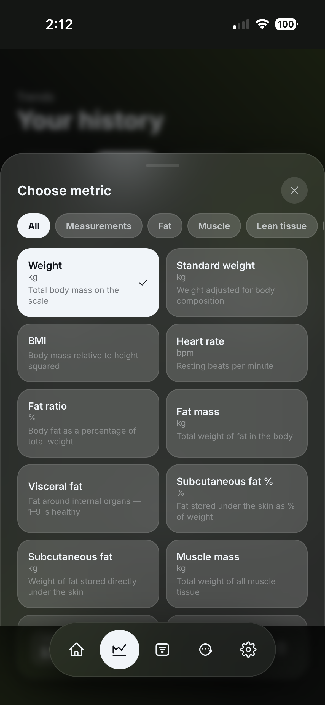
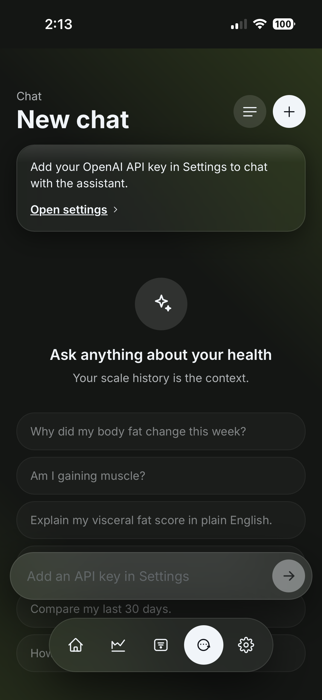
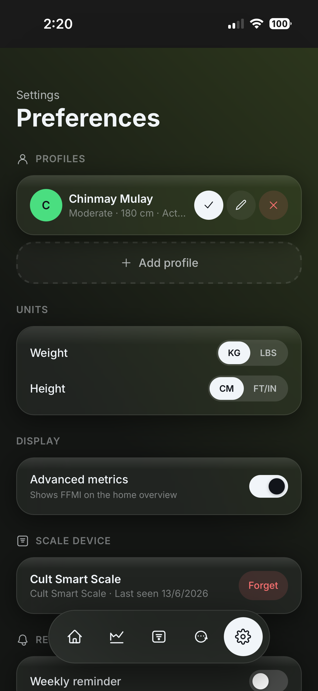
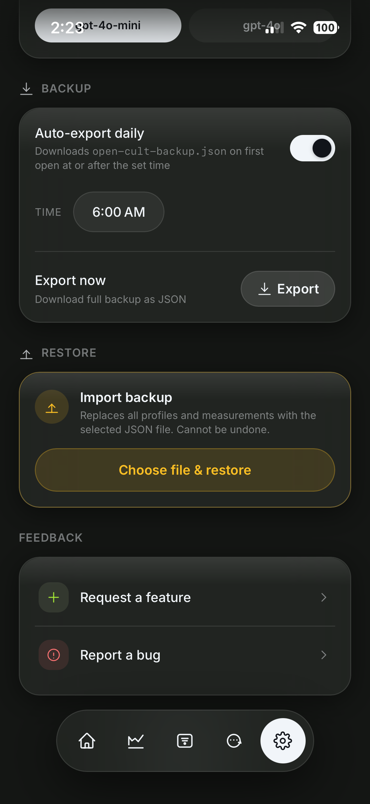
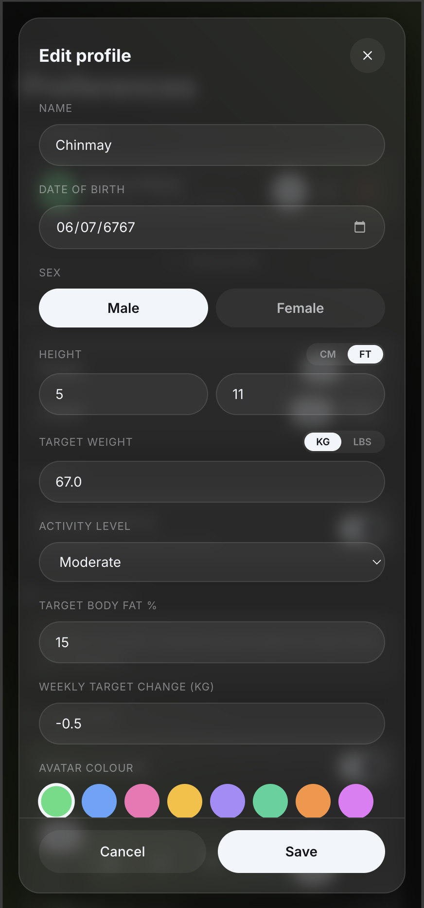

<div align="center">


# Open Cult

**An independent, privacy-first PWA for the Cult Smart Body Fat Scale (CS-BF01).**
Connect over Bluetooth, get a full body-composition breakdown, track trends, and chat with an AI coach. All data stays on your device.

[**Live app**](https://open-cult.vercel.app/) · [Docs](docs/) · [Report a bug](https://github.com/cmxau/opencult/issues) · [Request a feature](https://github.com/cmxau/opencult/issues)


</div>

---

## Screenshots

<table>
  <tr>
    <td align="center"><br /><sub><b>Dashboard</b></sub></td>
    <td align="center"><br /><sub><b>Connect scale</b></sub></td>
    <td align="center"><br /><sub><b>Weight trends</b></sub></td>
    <td align="center"><br /><sub><b>Metric picker</b></sub></td>
  </tr>
  <tr>
    <td align="center"><br /><sub><b>AI coach</b></sub></td>
    <td align="center"><br /><sub><b>Profiles &amp; units</b></sub></td>
    <td align="center"><br /><sub><b>Backup &amp; restore</b></sub></td>
    <td align="center"><br /><sub><b>Edit profile</b></sub></td>
  </tr>
</table>

## Features

| | |
| --- | --- |
| **Body composition** | Connects to the CS-BF01 over Web Bluetooth. Computes **26 raw** and **30+ derived** metrics from three scale values (weight, impedance, heart rate) using published formulas. |
| **History & trends** | Per-profile history grouped by month, trend charts for any metric, a body recomposition score, and time ranges from 1 week to all time. |
| **AI coach** | Persistent chat threads on OpenAI (GPT-4o / GPT-4o-mini). The model sees your profile, goals, and last 10 measurements. |
| **Multi-profile** | Up to 10 profiles per device, each with its own goals, avatar colour, and activity level. |
| **Data portability** | Manual JSON export / import, plus an optional daily auto-export. |
| **PWA** | Installable on iOS, Android, and desktop. Light / dark mode, kg / lbs, cm / ft·in, weekly weigh-in reminders, and reduced-motion support. |

<details>
<summary><b>Formulas used</b></summary>

- BMI, BMR (Mifflin-St Jeor 1990)
- Body fat % (Deurenberg et al. 1991)
- Total body water (Watson et al. 1980)
- Skeletal muscle mass (Janssen et al. 2000)
- Bone mass, protein, minerals (Pietrobelli 1998 / Roche 1996)
- Visceral fat level (Kuk et al. 2009)
- FFMI (Kouri et al. 1995), FMI (Schutz et al. 2002), ASMI (Baumgartner et al. 1998)
- Ideal weight range (Devine / Robinson / Hamwi)
- Days to goal (Hall et al. 2011 model)
- TDEE, calorie targets, fitness age, obesity and cardiometabolic risk scores

</details>

## Quick start

```bash
git clone https://github.com/cmxau/opencult.git
cd opencult
npm install
npm run dev
```

Open `http://localhost:5173` in Chrome or Edge. You need Node 18+ and, to take measurements, the CS-BF01 scale. More in [Getting started](docs/getting-started.md).

## Documentation

| Doc | What's in it |
| --- | --- |
| [Getting started](docs/getting-started.md) | Requirements, setup, first run |
| [Commands](docs/commands.md) | npm scripts and running tests |
| [Stack](docs/stack.md) | Libraries and why they were chosen |
| [Architecture](docs/architecture.md) | Layers, provider tree, feature modules, folder structure |
| [Data flow](docs/data-flow.md) | Scale to storage to screen, AI chat, backup |
| [Database schema](docs/database-schema.md) | Tables, indexes, ER diagram, migrations |
| [BLE protocol](docs/ble-protocol.md) | GATT UUIDs and the 11-byte packet format |
| [Deployment](docs/deployment.md) | Vercel and static hosting requirements |

## Platform support

| Platform     | Browser                                                                  | Web Bluetooth | Notes |
| ------------ | ------------------------------------------------------------------------ | :-----------: | ----- |
| Windows      | Chrome, Edge                                                             | ✅ | Full support |
| macOS        | Chrome, Edge                                                             | ✅ | Full support |
| Linux        | Chrome                                                                   | ✅ | Full support |
| Android      | Chrome                                                                   | ✅ | Full support |
| iOS / iPadOS | [Bluefy](https://apps.apple.com/app/bluefy-web-ble-browser/id1492822055) | ✅ | Safari and Chrome on iOS don't support Web Bluetooth, so use Bluefy |

The app works without a scale for viewing history and importing data.

## Privacy

- The only network requests go to OpenAI, and only when you start a chat or insight, using your own key.
- No analytics, telemetry, or accounts.
- Everything is stored in the browser's IndexedDB. Uninstalling the PWA or clearing site data removes it.
- Export your data at any time as plain JSON.

## Disclaimer

This is an unofficial, third-party project built for educational, research, and personal-interoperability purposes. It isn't affiliated with, endorsed by, or sponsored by the makers of the Cult Smart Body Fat Scale or any related brand. Product names are used only to describe hardware compatibility.

The metrics are computed from published bioimpedance formulas and are **not clinically validated**. Nothing here is medical advice. Bioimpedance readings vary with hydration, temperature, and posture, so treat every number as a trend indicator, not ground truth.

## Credits

This project builds on earlier open-source work on BLE scale reverse-engineering and body-composition formulas:

- [**openScale**](https://github.com/oliexdev/openScale): the most comprehensive open-source scale app for Android, and a key reference for BLE decoding.
- [**whoof**](https://github.com/madhursatija/whoof): a lean Web Bluetooth scale client that showed the browser-native approach was feasible.
- [**occult**](https://github.com/anshuman852/occult): an earlier web client for the CS-BF01 whose protocol exploration validated the 11-byte packet and XOR checksum.

## License

MIT, see [LICENSE](LICENSE). Product names are trademarks of their respective owners.
