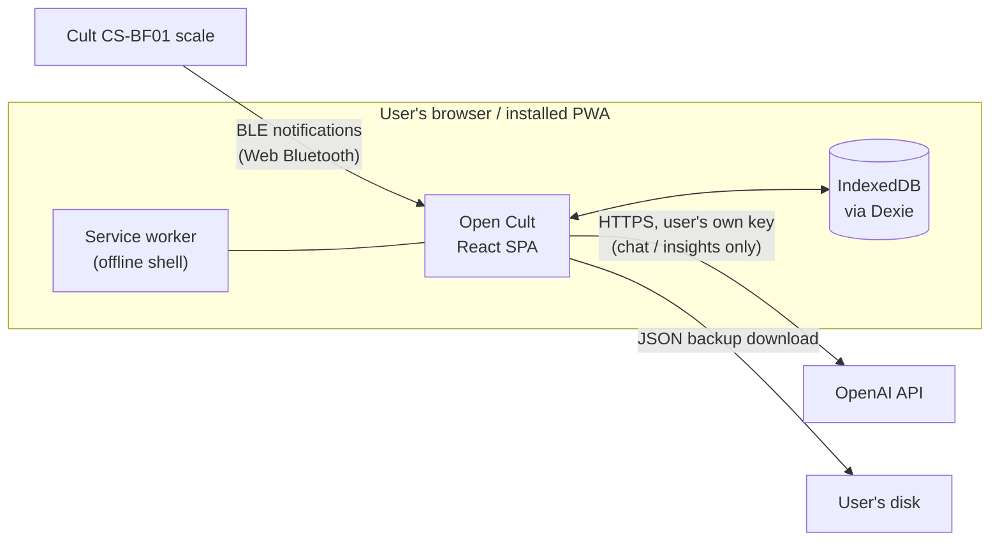
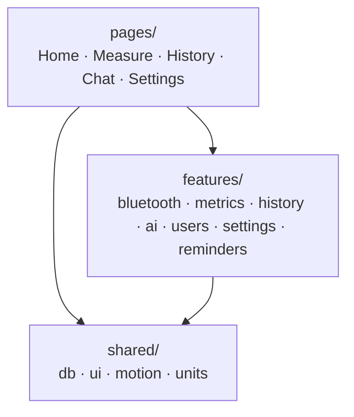
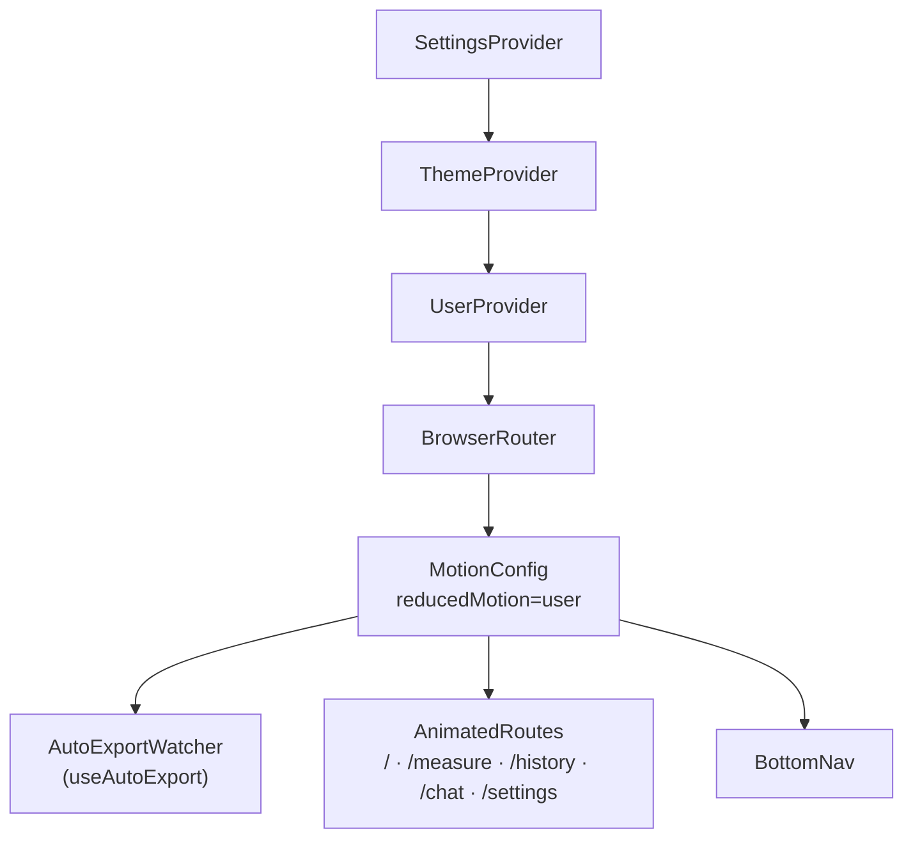

# Architecture

Open Cult is a client-only single-page app. There is no server. Everything runs in the browser and persists to IndexedDB.

## System context



## Layers

Dependencies point downward. Pages use features, features use shared code, and nothing in `shared/` imports from `features/`, with one exception (see the note below).



> The Dexie v3 migration in `shared/db/index.ts` dynamically imports `features/metrics` to backfill derived metrics. It is a dynamic import to avoid a circular load at module init.

## Runtime composition

`App.tsx` builds a provider tree, then routes inside an animated shell.



Order matters. `ThemeProvider` reads settings, and `UserProvider` reads the active user id from settings.

## Feature modules

| Module               | Responsibility                                                                 |
| -------------------- | ------------------------------------------------------------------------------ |
| `features/bluetooth` | `decoder.ts` parses packets. `useBluetooth.ts` scans, connects, streams, and records the device. |
| `features/metrics`   | Turns 3 scale values plus a profile into 26 raw and 30+ derived metrics. Also classification, categories, and trend stats. |
| `features/history`   | Measurement CRUD, JSON export / import, daily auto-export hook.                |
| `features/ai`        | OpenAI calls: single-shot insight (`openaiClient`), multi-turn chat (`chatService`), prompt building. |
| `features/users`     | Profile CRUD and `UserContext` (active user, profile list).                    |
| `features/settings`  | Settings singleton, `SettingsContext`, `ThemeContext`.                         |
| `features/reminders` | Weekly weigh-in notification, polled once a minute while the app is open.      |

### Metrics pipeline

| File                  | Role                                                           |
| --------------------- | -------------------------------------------------------------- |
| `computeFromScale.ts` | `RawMeasurement` (26 fields) from weight, impedance, heart rate, and profile |
| `index.ts`            | `computeDerivedMetrics()` produces `DerivedMetrics` (30+ fields) |
| `formulas.ts`         | Pure formulas: FFMI, ASMI, TDEE, ideal weight range, …         |
| `extended.ts`         | Scores and targets: FMI, fitness age, risk scores, days to goal |
| `classify.ts`         | ok / warn / alert status per metric                            |
| `categories.ts`       | Metric to category mapping, used by the metric picker          |
| `trends.ts`           | Trend stats and body recomposition score                       |

## Pages

| Route       | Page           | Purpose                                                              |
| ----------- | -------------- | -------------------------------------------------------------------- |
| `/`         | `HomePage`     | Dashboard: metric bento grid, trend chart, filter pills              |
| `/measure`  | `MeasurePage`  | BLE scan, live weigh-in, save measurement                            |
| `/history`  | `HistoryPage`  | Measurements grouped by month, per-metric trends, bottom-sheet picker |
| `/chat`     | `ChatPage`     | AI chat with thread management                                       |
| `/settings` | `SettingsPage` | Profiles, units, device, reminders, OpenAI, backup, feedback links   |

## Folder structure

```
src/
├── App.tsx                      # Provider tree, routes, AutoExportWatcher
├── main.tsx
├── index.css                    # CSS custom properties (light/dark), glass utilities
├── features/
│   ├── ai/                      # openaiClient, chatService, promptBuilder
│   ├── bluetooth/               # decoder, useBluetooth
│   ├── history/                 # historyService, useAutoExport
│   ├── metrics/                 # computeFromScale, index, formulas, extended, classify, categories, trends
│   ├── reminders/               # reminderService
│   ├── settings/                # settingsService, SettingsContext, ThemeContext
│   └── users/                   # userService, UserContext
├── pages/                       # Home, Measure, History, Chat, Settings
├── shared/
│   ├── db/                      # Dexie schema + migrations, all TypeScript types
│   ├── ui/                      # GlassCard, MetricCard, TrendChart, Modal, ConfirmDialog, …
│   ├── motion.ts                # Framer Motion variants and spring configs
│   └── units.ts                 # kg↔lbs, cm↔ft/in helpers
└── test/                        # Vitest suites mirroring features/
```

## Design decisions

- **Services and contexts, no global store.** Services are plain async functions over Dexie. Contexts hold only app-wide state (settings, theme, active user).
- **Derived metrics are stored, not recomputed.** Each `Measurement` persists both `raw` and `derived`, so history views are fast and old entries keep the formulas they were saved with. Migration v3 backfills this for older rows.
- **Browser-side OpenAI calls.** The client uses `dangerouslyAllowBrowser: true` because the key is user-supplied and local. There is no proxy, so the key never reaches any server other than OpenAI.
- **Reminders are best-effort.** Web Notifications can't fire in the background without a push server, so the reminder only fires while the app is open.

See also: [Data flow](data-flow.md) · [Database schema](database-schema.md) · [BLE protocol](ble-protocol.md)
