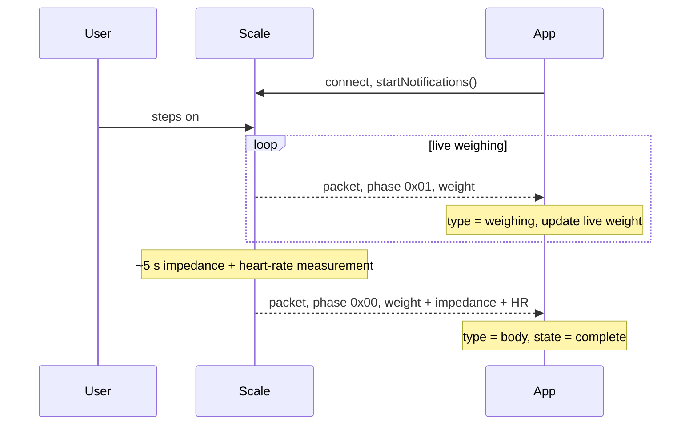

# BLE Protocol

The Cult CS-BF01 sends measurements as notifications on a single GATT characteristic, using a proprietary 11-byte packet. The format was reverse-engineered by [occult](https://github.com/anshuman852/occult) and informed by [openScale](https://github.com/oliexdev/openScale). The decoder is `src/features/bluetooth/decoder.ts`.

## GATT

| Item                  | UUID                                   |
| --------------------- | -------------------------------------- |
| Service               | `0000fff0-0000-1000-8000-00805f9b34fb` |
| Notify characteristic | `0000fff4-0000-1000-8000-00805f9b34fb` |

The app calls `requestDevice({ acceptAllDevices: true, optionalServices: [service] })`, because the scale's advertisement can't be relied on for filtering. It then connects, gets the service and characteristic, and calls `startNotifications()`.

## Packet layout

| Offset | Length | Field                                                  |
| ------ | ------ | ------------------------------------------------------ |
| 0      | 1      | Marker, must be `0xCF`                                 |
| 1      | 1      | Heart rate BPM (body phase only)                       |
| 2      | 1      | Signal quality / counter (ignored)                     |
| 3–4    | 2      | Weight, little-endian uint16, divide by 100 for kg     |
| 5–6    | 2      | Impedance, little-endian uint16, ohms (0 while weighing) |
| 7–8    | 2      | Reserved                                               |
| 9      | 1      | Phase: `0x01` = live weighing, `0x00` = body / HR locked |
| 10     | 1      | XOR checksum of bytes 0–9                              |

## Validation

A packet is discarded (decoded as `unknown`) if:

1. it is shorter than 11 bytes,
2. byte 0 is not `0xCF`, or
3. the XOR of bytes 0–9 does not equal byte 10.

## Phases



| Phase byte | Decoded `type` | Fields set                                      |
| ---------- | -------------- | ----------------------------------------------- |
| `0x01`     | `weighing`     | `weightKg`                                      |
| `0x00`     | `body`         | `weightKg`, `impedanceOhms`, `heartRateBpm`     |

In a `body` packet, impedance and heart rate are `undefined` when the raw value is 0, so a failed reading doesn't produce a bogus metric.

## Example

```
CF 48 00 A4 1B 7C 01 00 00 00 xx
│  │     └──┬──┘ └──┬──┘       └─ XOR of bytes 0–9
│  │        │       └─ impedance 0x017C = 380 Ω
│  │        └─ weight 0x1BA4 = 7076 → 70.76 kg
│  └─ heart rate 0x48 = 72 bpm
└─ marker
```

The sample is illustrative. Compute the checksum byte as the XOR of the first ten bytes.

## Notes and limits

- Impedance is the only bioimpedance input. All composition values are estimated from published formulas, not read from the device. See [Data flow](data-flow.md).
- Web Bluetooth does not expose the device MAC address, so the saved device record uses the advertised name as its identifier.
- Battery level isn't read (`batteryPct` is stored as `null`).
