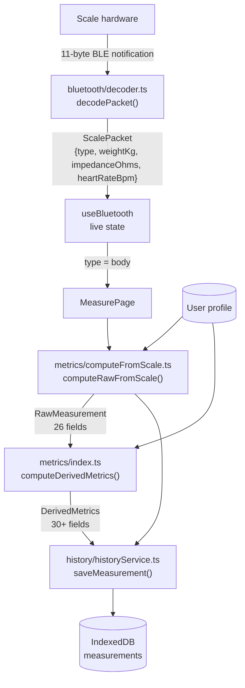
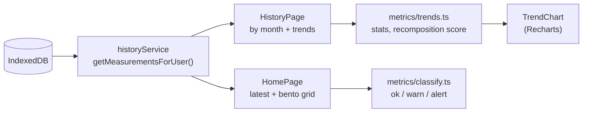
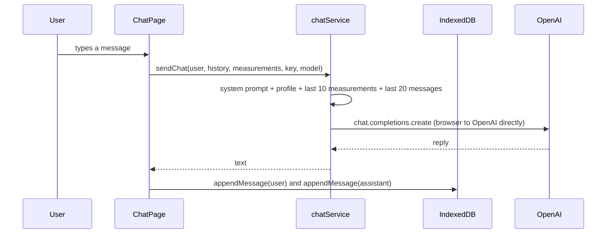
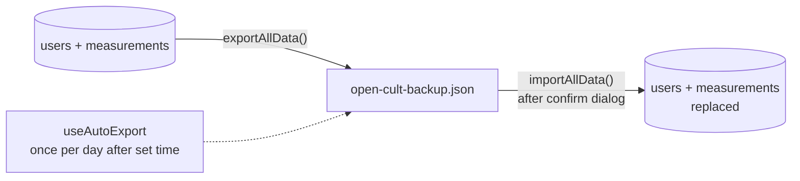

# Data Flow

## Measurement: scale to storage

Stored record: `Measurement { id, userId, timestamp, raw, derived, notes }`.

Only three values come from the scale (weight, impedance, heart rate). Everything else is computed from those and the user's profile (sex, age, height, activity level, goals) using published formulas.

### Packet phases

| Packet type | Meaning                                          | What the app does                          |
| ----------- | ------------------------------------------------ | ------------------------------------------ |
| `weighing`  | Live weight while the user steps on              | Updates the live weight display            |
| `body`      | Final locked weight, impedance, and heart rate   | Moves state to `complete` and records the device |
| `unknown`   | Wrong marker, short packet, or bad checksum      | Discarded                                  |

The Bluetooth hook moves through `idle → scanning → connecting → measuring → complete`, with `error` reachable from any step.

## Reading: storage to screen

## AI coach

Nothing is sent to OpenAI unless the user sends a chat message or requests an insight. The API key lives in the `settings` row in IndexedDB.

## Backup and restore

- **Manual:** export and import from Settings.
- **Auto-export:** on app open, if enabled and the configured time has passed and today hasn't been exported yet, the browser downloads `open-cult-backup.json`. The last-export date is kept in `localStorage`.
- **Scope:** the backup contains `users` and `measurements` only. Settings, the OpenAI key, devices, AI insights, and chat history are **not** included.
- **Import** validates that both arrays exist, then clears and replaces the two tables in one transaction.
