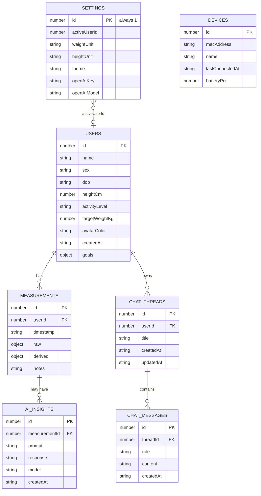

# Database Schema

IndexedDB database `OpenCultDB`, managed by Dexie. Current schema version: **4**. Definitions are in `src/shared/db/index.ts` and `src/shared/db/types.ts`.

## Entity relationships

Relationships are logical. IndexedDB has no foreign keys, so cascades are done in service code (for example `deleteMeasurement` also removes its insights, and `deleteThread` removes its messages).

## Tables and indexes

| Table          | Dexie store string               | Notes                                        |
| -------------- | -------------------------------- | -------------------------------------------- |
| `users`        | `++id, createdAt`                | Up to 10 profiles                            |
| `measurements` | `++id, userId, timestamp`        | `raw` and `derived` stored inline as objects |
| `devices`      | `++id, macAddress`               | `macAddress` currently holds the device name, since Web Bluetooth does not expose the MAC |
| `settings`     | `id`                             | Singleton row, always `id = 1`               |
| `aiInsights`   | `++id, measurementId, createdAt` |                                              |
| `chatThreads`  | `++id, userId, updatedAt`        |                                              |
| `chatMessages` | `++id, threadId, createdAt`      |                                              |

## Settings row

| Field                 | Type / values                         | Default       |
| --------------------- | ------------------------------------- | ------------- |
| `activeUserId`        | `number \| null`                      | `null`        |
| `weightUnit`          | `'kg' \| 'lbs'`                       | `'kg'`        |
| `heightUnit`          | `'cm' \| 'ft'`                        | `'cm'`        |
| `theme`               | `'light' \| 'dark' \| 'system'`       | `'system'`    |
| `reminderEnabled`     | `boolean`                             | `false`       |
| `reminderDayOfWeek`   | `0` (Sunday) to `6`                   | `1` (Monday)  |
| `reminderTimeHHMM`    | `"HH:MM"`                             | `"08:00"`     |
| `openAIKey`           | `string`                              | `''`          |
| `openAIModel`         | `'gpt-4o-mini' \| 'gpt-4o'`           | `'gpt-4o-mini'` |
| `autoExportEnabled`   | `boolean`                             | `false`       |
| `autoExportTime`      | `"HH:MM"`                             | `"06:00"`     |
| `showAdvancedMetrics` | `boolean`                             | `false`       |

## Migrations

| Version | Change |
| ------- | ------ |
| v1      | Initial: `users`, `measurements`, `devices`, `settings`, `aiInsights` |
| v2      | Adds `chatThreads` and `chatMessages`. Splits legacy `units` into `weightUnit` / `heightUnit` and defaults `theme` to `system`. |
| v3      | Backfills `derived` metrics on existing measurements (recomputed from `raw` and the user, with zero placeholders if the user is missing). Defaults `targetWeightKg` to 70 where missing. |
| v4      | Adds `showAdvancedMetrics` (default `false`) to settings. |

Only v2 adds tables. v3 and v4 change data, not indexes.

## Measurement payload

`raw` (`RawMeasurement`, 26 fields) covers weight, BMI, BMR, heart rate, water, bone, muscle, skeletal muscle, fat, visceral fat, subcutaneous fat, lean mass, protein, minerals, body type, body age, health score, and weight control.

`derived` (`DerivedMetrics`, 30+ fields) covers indices (FFMI, FMI, ASMI, ratios), classifications, metabolism (TDEE and calorie targets), 0–100 health scores, and goal targets (ideal weight range, target fat and lean mass, estimated days to goal).

See `src/shared/db/types.ts` for the full field list.
